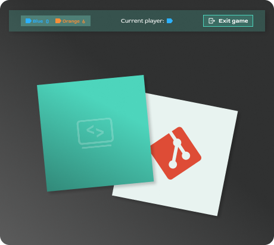
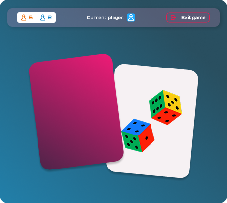

<div align="center">

# 🃏 Memory

**Ein Memory-Kartenspiel für zwei Spieler – gebaut mit TypeScript, SCSS und Vite, ganz ohne Framework.**


</div>

---

## 📖 Über das Projekt

Zwei Spieler – **Blau** und **Orange** – decken abwechselnd je zwei Karten auf.
Wer ein passendes Paar findet, bekommt einen Punkt und darf weiterspielen.
Passen die Karten nicht zusammen, werden sie wieder umgedreht und der andere Spieler ist dran.
Sind alle Paare gefunden, gewinnt der Spieler mit den meisten Punkten.

Das Projekt ist im Rahmen einer **Weiterbildung** entstanden. Der Schwerpunkt liegt darauf,
eine Single Page Application mit reinem TypeScript zu verstehen: DOM-Manipulation,
eigener Router, Spiellogik und themenbasiertes Styling.

## 🎨 Themes

<table>
  <tr>
    <td align="center"><br /><b>Code vibes</b></td>
    <td align="center"><br /><b>Gaming</b></td>
  </tr>
</table>

Weitere Themes (*DA Projects*, *Foods*) sind vorbereitet, aber noch nicht freigeschaltet.

## ✨ Features

- 👥 **Zwei Spieler** an einem Gerät, mit Punkteanzeige und Anzeige des aktuellen Spielers
- 🎨 **Zwei Themes** mit eigenen Farben, Kartenmotiven und Spielerfiguren
- 🔢 **Drei Spielfeldgrößen:** 16, 24 oder 36 Karten
- 📐 **Responsive Spielfeld:** Die Karten passen sich der Fensterhöhe an
- 🏆 **Endbildschirme** für Sieg, Unentschieden und Game over
- 🚪 **Exit-Dialog** mit Sicherheitsabfrage, um ein laufendes Spiel zu verlassen
- 💾 **Einstellungen bleiben erhalten**, auch wenn die Seite neu geladen wird

## 🚀 Installation & Start

**Voraussetzung:** [Node.js](https://nodejs.org/) (empfohlen: Version 20 oder neuer)

```bash
# Repository klonen
git clone https://github.com/BockDA/memory.git
cd memory

# Abhängigkeiten installieren
npm install

# Entwicklungsserver starten
npm run dev
```

Danach ist das Spiel unter **http://localhost:5173** erreichbar.

### Verfügbare Befehle

| Befehl            | Beschreibung                                               |
| ----------------- | ---------------------------------------------------------- |
| `npm run dev`     | Startet den Entwicklungsserver mit automatischem Neuladen  |
| `npm run build`   | Prüft die Typen und erstellt eine optimierte Version in `dist/` |
| `npm run preview` | Zeigt die gebaute Version aus `dist/` lokal an             |

## 🗂️ Projektstruktur

```
memory/
├── index.html               # Einstiegspunkt der App
├── public/                  # Bilder, Fonts und Theme-Grafiken
└── src/
    ├── main.ts              # Startet die App und fängt Link-Klicks ab
    ├── router.ts            # Eigener Router (History API)
    ├── settings.ts          # Spielereinstellungen und Theme-Interface
    ├── style.scss           # Globale Styles
    ├── assets/JSON/
    │   ├── cards.json       # Kartenmotive pro Theme
    │   └── theme.json       # Farben und Bilder pro Theme
    ├── pages/
    │   ├── home/            # Startseite
    │   └── options/         # Auswahl von Theme, Spieler und Spielfeldgröße
    ├── playfield/
    │   ├── playfield.ts     # Aufbau des Spielfelds und der Karten
    │   └── gameLogic.ts     # Spielregeln, Punkte und Spielerwechsel
    ├── endscreen/           # Winner-, Draw- und Game-over-Bildschirm
    └── styles/              # SCSS-Variablen, Mixins und Typografie
```

## 🛠️ Technischer Überblick

- **Kein Framework:** Die Seiten werden als HTML-Templates geladen (`?raw`-Import von Vite)
  und per `innerHTML` in die Seite eingesetzt.
- **Eigener Router:** `router.ts` ordnet jedem Pfad eine Render- und eine Init-Funktion zu
  und nutzt die History API (`pushState` / `popstate`) für die Navigation ohne Neuladen.
- **Themes über JSON:** Farben und Bilder stehen in `theme.json` und werden zur Laufzeit
  als CSS-Variablen gesetzt. Dadurch braucht jedes Theme kein eigenes Stylesheet.
- **Spiellogik getrennt vom Aufbau:** `playfield.ts` erzeugt die Karten,
  `gameLogic.ts` entscheidet über Treffer, Punkte und das Spielende.

## 👤 Autor

**BockDA** – [github.com/BockDA](https://github.com/BockDA)

---

<div align="center">
<sub>Entstanden im Rahmen einer Weiterbildung zum Thema Webentwicklung.</sub>
</div>
